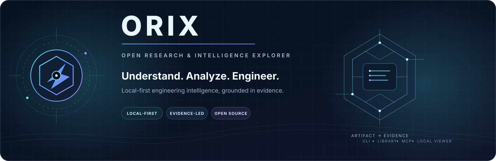

  

  
<strong>Understand. Analyze. Engineer.</strong>

  
Local-first engineering intelligence for inspecting software artifacts, understanding codebases, and preserving the evidence behind every conclusion.

  

    
    
    
    
    
  

  

    <a href="#why-orix">Why ORIX</a> ·
    <a href="#capabilities">Capabilities</a> ·
    <a href="#quick-start">Quick start</a> ·
    <a href="#interfaces">Interfaces</a> ·
    <a href="#security-and-trust-boundaries">Security</a> ·
    <a href="#documentation">Documentation</a>
  

---

## What is ORIX?

**ORIX — Open Research & Intelligence eXplorer** is an evidence-first engineering workbench. It helps developers, researchers, and authorized analysts inspect files, map source repositories, review dependencies, examine supported binary structures, and turn observations into reproducible reports.

ORIX is designed around one simple rule: **a conclusion should never lose the evidence, provenance, coverage, or limitations behind it.**

It is not a claim that one parser replaces every specialist tool. ORIX provides a coherent local workflow and integrates selected specialist capabilities through explicit, optional adapters.

> Current release line: **0.5.0 — Artifact, Project, Evidence, Interchange + MCP Intelligence**  
> **Runtime:** Node.js 20.11+ · **Runtime dependencies:** Node.js built-ins only · **Core mode:** local, static analysis

Product direction and release scope are intentionally separated. The [Product Charter](docs/PRODUCT_CHARTER.md), [Capability Matrix](docs/CAPABILITY_MATRIX.md), and [Implementation Backlog](docs/IMPLEMENTATION_BACKLOG.md) describe the target and planned work; they are not proof that every planned capability is already available.

## Why ORIX?

| Principle | What it means in practice |
|---|---|
| **Evidence before conclusions** | Hashes, parser observations, source locations, rule IDs, confidence and limitations remain attached to reports. |
| **Local-first by default** | Core inspection runs locally without an account, cloud service or paid API. |
| **Static and bounded** | Inputs, traversal, parser work, output and concurrency have explicit ceilings. Inspected samples and project scripts are not executed by core analysis. |
| **Honest coverage** | Unsupported structures, truncation, skipped files and provider failures stay visible. |
| **Consistent interfaces** | CLI, JavaScript API and local stdio MCP share versioned report and evidence models where each interface exposes them. |
| **Interoperable output** | Export JSON, Markdown, SARIF and CycloneDX data for downstream review and tooling. |

## Capabilities

The following are working areas in the current repository, with intentionally bounded scope.

<table>
  <tr>
    <td width="50%">
      <h3>01 · Artifact intelligence</h3>
      
Identify, hash and structurally inspect supported files with bounds-checked parsers, entropy, strings and explainable static indicators.

      
PE · ELF · Mach-O · WebAssembly · PDF · ZIP · PNG · PCAP/PCAPNG · APK · firmware metadata

      <a href="docs/FORMATS.md">Format support matrix →</a>
    </td>
    <td width="50%">
      <h3>02 · Repository intelligence</h3>
      
Inventory source trees, inspect supported lockfiles, map import relationships, surface architecture signals and review selected Electron settings—without running project scripts.

      <a href="docs/PROJECT_INTELLIGENCE.md">Project intelligence →</a>
    </td>
  </tr>
  <tr>
    <td width="50%">
      <h3>03 · Evidence and investigations</h3>
      
Keep SHA-256 identities, append-only evidence events, analysis records, finding lifecycles, notes and portable case bundles.

      <a href="docs/CASES.md">Investigation cases →</a> · <a href="docs/SECURITY_MODEL.md">Evidence boundaries →</a>
    </td>
    <td width="50%">
      <h3>04 · Reports and interoperability</h3>
      
Generate JSON, Markdown, SARIF 2.1.0 and CycloneDX 1.5 outputs, compare reports, and expose bounded tools through a local stdio MCP server.

      <a href="docs/MCP.md">MCP integration →</a> · <a href="docs/CLI.md">CLI reference →</a>
    </td>
  </tr>
</table>

### More implemented slices

- **Network capture metadata:** offline HAR 1.2 analysis; no request replay or live capture.
- **Firmware metadata:** bounded UBI/UBIFS, SquashFS, cramfs, GZIP, CPIO and TAR structure inventory; no filesystem mounting or extraction.
- **Dependency intelligence:** supported lockfile inventory and an explicit opt-in OSV advisory lookup for exact resolved package versions.
- **Optional Rizin adapter:** static import/function/disassembly workflows with tool/version provenance. Rizin must be installed separately.
- **Local report explorer:** open supported ORIX JSON reports in a browser-local viewer; report parsing stays in the browser tab.

**Coverage varies by format.** Some formats have a useful structural parser; JPEG and SQLite are currently signature-recognition only. A recognized signature is not the same as a complete parser, semantic validation, or trust verification. See the [full format matrix](docs/FORMATS.md).

## How the workflow fits together

~~~mermaid
flowchart LR
    A["Local artifact or source tree"] --> B["Bounded intake + SHA-256"]
    B --> C["Format parsers / project analyzers"]
    C --> D["Evidence + explainable findings"]
    D --> E["JSON · Markdown · SARIF"]
    D --> F["Cases · Evidence ledger"]
    G["CLI · JavaScript API · MCP stdio"] --> B
    H["Optional Rizin / OSV enrichment"] -. "explicit opt-in" .-> C
    J["Saved ORIX JSON report"] --> I["Local report explorer"]
~~~

The report explorer reads an exported report locally. Optional enrichment is separate from the offline core path and must be explicitly requested.

## Quick start

### Requirements

- Node.js **20.11 or newer**
- Git
- No third-party runtime dependencies are required by the core package.

### Clone and run

~~~bash
git clone https://github.com/monsterjack-404/Orix.git
cd Orix

# Install the locked development/tooling dependencies
npm ci

# Validate source and documentation, then run tests
npm run check
npm test
~~~

### Inspect an artifact

~~~bash
# Human-readable report
node src/cli.mjs inspect ./sample.exe

# Machine-readable JSON
node src/cli.mjs inspect ./sample.exe --json

# Bounded directory scan
node src/cli.mjs scan ./build --max-files 3000 --max-depth 16 --concurrency 4

# See the live capability inventory
node src/cli.mjs capabilities --json
~~~

### Explore a source repository

~~~bash
node src/cli.mjs project ./source-tree
node src/cli.mjs architecture ./source-tree
node src/cli.mjs project ./source-tree --format cyclonedx --out ./sbom.cdx.json
node src/cli.mjs project ./source-tree --format sarif --out ./project-findings.sarif
~~~

### Review a network capture or compare reports

~~~bash
# Offline HAR metadata analysis
node src/cli.mjs har ./capture.har

# Compare two saved reports
node src/cli.mjs compare ./baseline.json ./current.json --json
~~~

For every command and flag, see the [CLI and Automation Guide](docs/CLI.md).

## Interfaces

| Interface | Entry point | Best for |
|---|---|---|
| **CLI** | <code>node src/cli.mjs</code> | Human workflows, scripts and repeatable automation |
| **JavaScript API** | <code>src/index.mjs</code> | Calling parsers and analysis services from Node.js |
| **MCP server** | <code>npm run mcp</code> | Local AI clients that support MCP stdio |
| **Report explorer** | <code>npm run web</code> | Reviewing saved JSON reports in a local browser |

Start the local MCP server:

~~~bash
npm run mcp
~~~

Start the local report explorer:

~~~bash
npm run web
# Open http://127.0.0.1:4173
~~~

The report explorer binds to loopback and applies a fixed asset allowlist and restrictive Content Security Policy. It is a report viewer, not a hosted dashboard. See the [viewer guide](docs/WEB_VIEWER.md).

## Reports and evidence

| Output / workflow | Purpose |
|---|---|
| **JSON** | Structured records for automation and integrations |
| **Markdown** | Readable investigation summaries |
| **SARIF 2.1.0** | Static findings for code-scanning workflows |
| **CycloneDX 1.5** | SBOM export from supported project/lockfile data |
| **Evidence ledger** | Append-only SHA-256 hash-chained JSONL records |
| **Investigation cases** | Workspace-local analysis history, notes, findings and portable bundles |

Evidence ledgers are tamper-evident, not tamper-proof. Portable case bundles are unsigned and do not include original sample bytes by default. Always preserve the original artifact separately when it is required for later verification.

## Security and trust boundaries

ORIX's built-in analysis is **static and read-only**: it reads bytes, calculates hashes, parses supported structures and writes optional reports. It does not execute the inspected artifact, load its libraries, attach to target processes, or run project build scripts.

A few important boundaries:

- Parser, file, scan and output work is bounded; symlink handling and file-identity checks reduce common path/input risks.
- Static indicators are review leads—not malware verdicts, vulnerability confirmation, or proof of runtime behavior.
- OSV enrichment is networked and opt-in; the core inspection path does not require it.
- Optional external providers are separate processes. On the current <code>main</code> release, the provider runner is **not an OS sandbox** and does not confine provider filesystem or network access.
- Dynamic target execution, a hosted service, remote MCP transport and a multi-user database are not part of the current release.

Read the [Security Model](docs/SECURITY_MODEL.md), [Security Policy](SECURITY.md), and [Provider Guide](docs/PROVIDERS.md) before using external tools on sensitive systems.

## Documentation

| Guide | What you'll find |
|---|---|
| [CLI and automation](docs/CLI.md) | Commands, flags, output formats and workflows |
| [Format support](docs/FORMATS.md) | Parser status, implemented structures and unsupported areas |
| [Project intelligence](docs/PROJECT_INTELLIGENCE.md) | Repository inventory, lockfiles, source analysis and SBOM |
| [Architecture analysis](docs/ARCHITECTURE-ANALYSIS.md) | Import graph and structural metrics |
| [Static indicators](docs/INDICATORS.md) | Rule IDs, severity, confidence and false-positive guidance |
| [WebAssembly analysis](docs/WASM_ANALYSIS.md) | WebAssembly parser fields, ceilings and exclusions |
| [Dependency vulnerability intelligence](docs/VULNERABILITY-INTELLIGENCE.md) | Opt-in OSV lookup and coverage limitations |
| [Core architecture](docs/ARCHITECTURE.md) | Module ownership, data flow and extension boundaries |
| [Competitive landscape](docs/COMPETITIVE_LANDSCAPE.md) | Research context and adapter priorities |
| [Investigation cases](docs/CASES.md) | Case lifecycle, events, reports and bundles |
| [Evidence and security model](docs/SECURITY_MODEL.md) | Threats, controls, residual risks and trust boundaries |
| [Provider integration](docs/PROVIDERS.md) | Provider manifests, process control and Rizin workflows |
| [MCP integration](docs/MCP.md) | Local stdio server, tool schemas and workspace boundaries |
| [Web report explorer](docs/WEB_VIEWER.md) | Local report viewing and privacy model |
| [Roadmap](docs/ROADMAP.md) | Implemented milestones and next engineering slices |
| [Capability matrix](docs/CAPABILITY_MATRIX.md) | Implemented, partial and planned capability status |
| [Product charter](docs/PRODUCT_CHARTER.md) | Long-term principles and target architecture |
| [Changelog](CHANGELOG.md) | Release history and notable changes |

## Contributing

ORIX is built in small, testable vertical slices. Before proposing a parser or workflow, check the existing capability boundary and documentation. New format work should include valid and malformed fixtures, explicit limits, unsupported-case behavior and format documentation.

~~~bash
npm ci
npm run check
npm test
npm run test:coverage
~~~

See [CONTRIBUTING.md](CONTRIBUTING.md) for contribution expectations. Security issues should be reported using [SECURITY.md](SECURITY.md), not as public exploit details.

## License

ORIX is licensed under the [Apache License 2.0](LICENSE). Optional third-party engines and format specifications retain their own licenses and attribution requirements.

---

  Built around clear boundaries, reproducible work, and evidence you can inspect. 
  <strong>ORIX · Understand. Analyze. Engineer.</strong> 
  <a href="https://github.com/monsterjack-404/Orix">Star or follow the project on GitHub</a>

